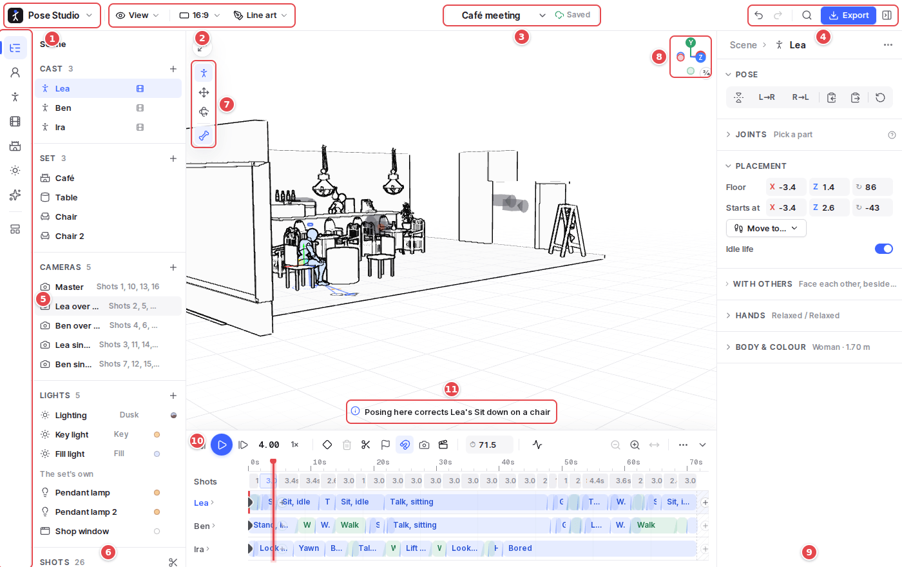

# Pose Studio

A posable 3D mannequin for drawing reference, and a small studio for blocking scenes. Pose figures by dragging their hands, feet and hips; put them in a set, make them walk and act on a timeline; film them in shots; and export pose sheets, storyboards, video, or packs for AI video tools.



## Documentation

- **[User guide](docs/guide/README.md)**: the app part by part, with annotated screenshots: posing, figures and props, the Library, scenes and sets, animation, cameras, lighting, storyboard and export.
- **[Architecture](docs/architecture.md)**: how the code is laid out, its modules, its conventions and its assets.
- **[Architecture decision records](docs/adr/README.md)**: the decisions the code is built on, and why.
- **[UI rules](docs/UI.md)**: the standard every part of the interface follows.

## Editions

One codebase builds two editions:

| | Static | Server |
| --- | --- | --- |
| Runs on | GitHub Pages or any static host | Node or Docker |
| Posing, animation, storyboard, export, photo posing | ✓ in the browser | ✓ |
| Sign-in (Google, Microsoft), library synced across devices | | ✓ NextAuth, Prisma + SQLite |
| AI assistant | | ✓ Azure OpenAI or OpenAI, with the server's key |

## Build and run

Requires Node 20.9+ and a browser with WebGL.

```bash
npm install          # also fetches the on-device pose model (~9 MB) into public/mediapipe
npm run dev          # http://localhost:3000
```

### Static edition

```bash
npm run build:static                                    # → out/
NEXT_PUBLIC_BASE_PATH=/pose-studio npm run build:static  # served from a sub-path
```

Pushing to `main` deploys it to GitHub Pages (`.github/workflows/pages.yml`; enable *Settings → Pages → Source: GitHub Actions* once).

### Server edition

Copy `.env.example` to `.env` and fill it in:

| Variable | For |
| --- | --- |
| `NEXTAUTH_URL`, `NEXTAUTH_SECRET` | The public URL, and a secret (`openssl rand -base64 32`) |
| `GOOGLE_CLIENT_ID`, `GOOGLE_CLIENT_SECRET` | Google sign-in (redirect: `{NEXTAUTH_URL}/api/auth/callback/google`) |
| `AZURE_AD_CLIENT_ID`, `AZURE_AD_CLIENT_SECRET`, `AZURE_AD_TENANT_ID` | Microsoft sign-in (redirect: `{NEXTAUTH_URL}/api/auth/callback/azure-ad`) |
| `AZURE_OPENAI_ENDPOINT`, `AZURE_OPENAI_API_KEY`, `AZURE_OPENAI_DEPLOYMENT` (or `OPENAI_API_KEY`, `OPENAI_MODEL`) | The AI assistant; `AI_DAILY_LIMIT` caps requests per user per day (default 200) |
| `DATABASE_URL` | The SQLite file (default `file:./data/pose-studio.db`) |
| `ASSETS_DIR` | Where users' imported motions and characters are kept (default `assets/` beside the database) |

Each sign-in provider appears when it is configured.

```bash
npm run db:migrate && npm run dev                      # local
npm run build && npm start                             # production
docker compose up --build                              # or Docker, the database on a volume
# (or: docker build -t pose-studio . && docker run -p 3000:3000 --env-file .env -v pose-studio-data:/data pose-studio)
```

The image applies pending migrations on start, keeps the database on the `/data` volume, runs as a non-root user and answers `GET /api/health`.

### Checks

| Script | What it does |
| --- | --- |
| `npm run check` | Type-check, lint, unit tests and the slow ones |
| `npm test` | Unit tests (Vitest) |
| `npm run test:related` | The unit tests affected by what changed |
| `npm run test:slow` | The slow unit tests (every motion and coverage on every body build); CI runs them on every push |
| `npm run test:e2e` | Browser tests (Playwright) against the server edition; starts the app unless `BASE_URL` is set |

CI (`.github/workflows/ci.yml`) runs the checks, the slow tests in 3 shards and the browser tests in 4 shards on every push.

### Asset scripts

`npm run sets`, `npm run set-thumbs`, `npm run motions`, `npm run setup:mediapipe` and `npm run doc-shots` prepare the committed assets and the guide's screenshots; see [Architecture → Assets](docs/architecture.md#assets).

## Credits

The characters, sets, textures and skies come from Quaternius, MakeHuman, Mixamo, Poly Haven, ambientCG and Sketchfab authors, under CC0, CC BY 4.0 and their own terms. Each is credited in [`public/characters/CREDITS.txt`](public/characters/CREDITS.txt) and [`public/sets/CREDITS.txt`](public/sets/CREDITS.txt), and in the app beside the item.
