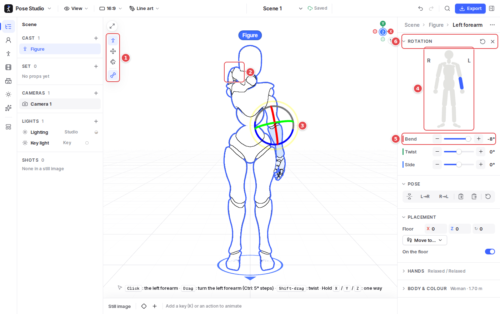
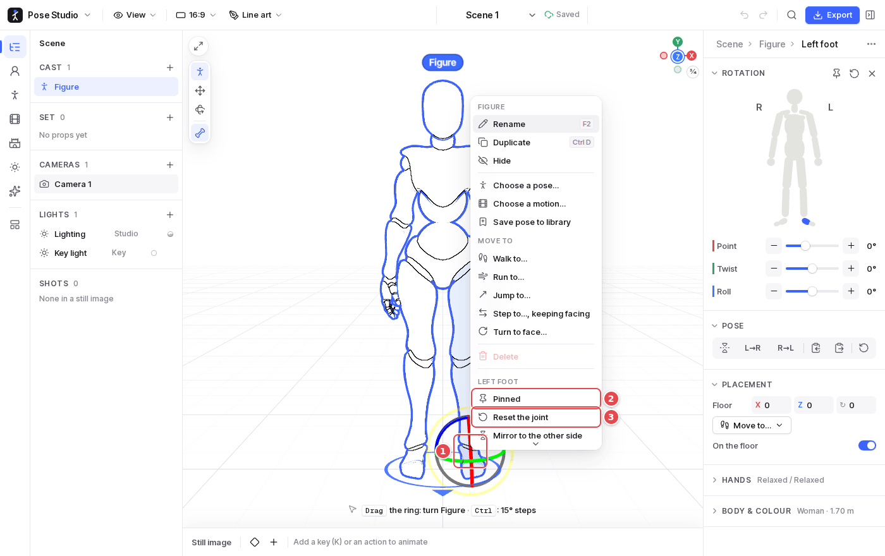

# 2. Posing

1. **The tools** say what a drag on a figure does:
   - **Pose** (`Q`, the default): a hand or foot **reaches**, the arm or leg following it (IK). Any other part **swings** from its joint. The hips **sink or shift** with the feet staying planted, to drop into a squat or shift the weight.
   - **Move** (`W`): any part places **the whole figure** on the floor. Shift-drag turns it. In an animated scene this moves everything the figure does.
   - **Rotate** (`E`): any part **turns at its joint**, hands and feet too.
   - **Body follows** (the last button): when a hand reaches beyond the arm, the shoulder and chest come along.
2. **A hand reached up** with the Pose tool: dragged from where it hung, the arm followed.
3. **The selected part** (here the left forearm) shows its rotate gizmo: its rings turn it about its own axes, and the ring facing the view turns it freely. Dragging the part itself also turns it. Hold `X`, `Y` or `Z` while dragging to turn only that way. `Ctrl` snaps to 5° steps; `Shift`-drag twists it.
4. **The body map**: click a part on it to select it, the figure's left and right as seen from its front.
5. **The part's sliders** (Bend, Twist, Side, in the axes' colours): **−** and **+** step 5° (Shift 15°, repeating while held), and clicking the value lets you type an exact angle.
6. **The part's header** resets the part (⟲) or deselects it (×). `Esc` goes up to the whole figure instead.

The hint at the bottom says what a click and a drag do on what is under the pointer.

## Pins

1. **A hand or foot** right-clicked is selected, and its menu has its own commands.
2. **Pinned** keeps it where it is while the rest of the body is posed: a pinned foot stays planted as you drag the hips or the chest. A pinned part has a blue mark; click Pinned again to free it. A pin also has its button in the part's inspector header.
3. **Reset the joint**, **Mirror to the other side**, and **the joint above or below** are in the same menu.

## Whole-pose tools

The figure's inspector has, at the top, **Pose** tools:

- mirror the pose;
- copy one side to the other (**L→R**, **R→L**);
- copy and paste the pose;
- reset it.

`M` mirrors from the keyboard, and undo (`Ctrl Z`) goes back 200 steps.

## From the keyboard

With a part selected:

- `↑` `↓` go to the joint above or below, `←` `→` to the other side.
- Hold `X`, `Y` or `Z` and press `←` `→` to step that slider 5°.

With a figure selected:

- the arrows move it 5 cm the way the screen shows;
- `Alt` + `←` `→` turns it 15°;
- `Shift` takes three steps.

In an animated scene, each step is keyed at the playhead like a drag.

**Joint limits** (View menu) keep parts within how far a body bends.
