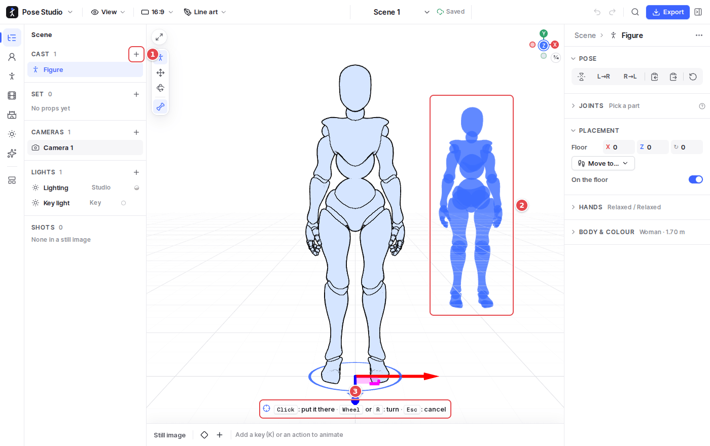
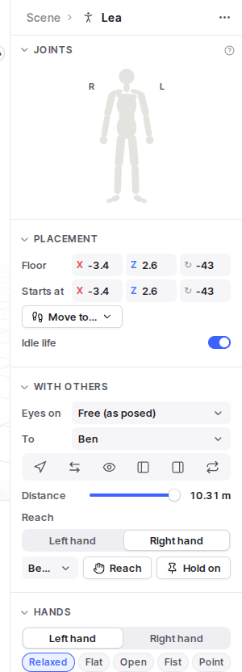

# 3. Figures and props

1. **Add to cast** (the Cast heading's **+** in the Scene outline): a figure, or a stand-in for blocking (an extra, a crowd), standing, sitting or lying. **Add to set** (the Set heading's **+**) adds props: a box, ball, cylinder, chair, stool, step, wall, sports gear (a mat, a basketball hoop, high-jump uprights), and things held in a hand (a stick, a gym hoop, a ribbon, a phone, a cup, a book).
2. **Adding is placing**: what you add follows the pointer as a ghost on the floor, snapping to the 25 cm grid (`Alt`: off it) and beside or facing the nearest figure. The wheel or `R` turns it 15°, a click puts it down, and `Esc` cancels. A hand prop goes into the hand of the figure you click.
3. **The hint** says what the click, the wheel and `Esc` do while placing.

Right-click the empty floor to add a figure, a stand-in or a prop at that spot. Chosen from the keyboard, it is put down at once.

## The figure's inspector

With a figure selected, its inspector has these sections, from the top:

- **Pose**: mirror, copy a side to the other, copy and paste, reset (see [Posing](02-posing.md)).
- **Joints**: the body map; pick a part there to see its sliders.
- **Placement**: where it stands on the floor (X, Z) and which way it faces, to type exactly. In an animated scene, **Starts at** is where its performance begins. **Move to…** walks, runs or jumps it to a spot. **On the floor** off lets it sit on a prop or be lifted. **Idle life** keeps it breathing and glancing around between actions.
- **With others**:
  - **Eyes on** keeps its head turned to another figure or a prop.
  - The row of buttons, with the other figure picked in **To**: **Turn to** them, **Face each other**, **Look at** them, stand **Beside** them (left or right) or **Back to back**.
  - **Distance** sets how far apart they stand.
  - **Reach** puts a hand on their head, shoulder, chest, back, waist or hand; **Hold on** keeps it there as both move.
- **Hands**: each hand's preset (relaxed, flat, open, fist, point, peace, grip, thumbs up, claw), and each finger's curl and the spread. **Copy to the other hand** copies it across.
- **Body & colour**: a man or a woman, the height, the build (slimmer to heavier), a tint to tell people apart in a busy scene, and the **character** the figure is drawn as.

Dragging a hand onto someone else does the same as Reach: it holds on at the nearest point a hand can hold, and the hint names it.

## Props

- **Drag** a prop to move it on the floor, turn it by its floor ring, raise it with its gizmo, and `R` switches to scaling. Its inspector has exact position, rotation and size (drag a field's letter to scrub).
- **Held props**: a small prop can be put in a hand (**Held by** in its inspector, or its menu). It follows the hand through poses and animation, and dragging it moves the hand. **Let go** sets it down.
- **Physics** (balls, boxes and the like): how much it bounces and grips when thrown, passed, shot or dropped. A reset button brings back the default.
- **Several at once**: Shift-click figures and props to pick them together, then drag one to move them all. Their panel duplicates, hides or deletes them together.

## Characters

A figure can be drawn as a character instead of the mannequin: pick one in **Body & colour**, or drag one from **Library → Characters** onto it. Eighteen come with the app; **Import character…** takes a VRM, glTF/GLB or FBX with a skeleton (VRoid, Mixamo…). A character is posed and animated exactly as the mannequin would be.
