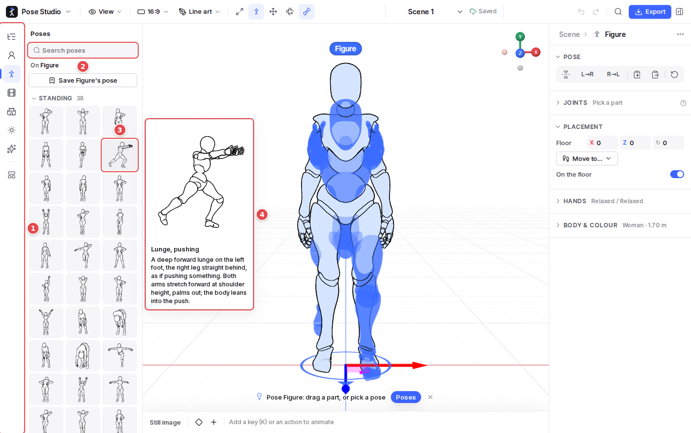
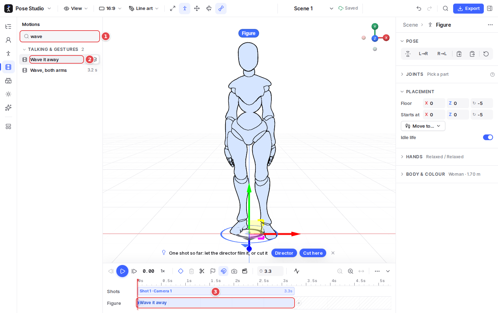

# 4. The Library

The Library is five sections of the rail: **Characters**, **Poses**, **Motions**, **Sets** and **Lighting**. Each has its own search box and groups that fold. What you pick applies to what is selected, and anything can also be dragged onto what it applies to.

## Poses

1. **The rail**: the Library's sections, under the Scene outline.
2. **Search** the section by name or description.
3. **A pose**: click it to put it on the selected figure, where it stands. In an animated scene, it is keyed at the playhead. **Save Figure's pose** (above the grid) keeps your own in the library.
4. **Resting the pointer** on an item shows a preview with its description, and the selected figure shows it as a ghost.

The poses are grouped by posture (standing, sitting and squatting, kneeling and all fours, lying…): the 20 reference poses of the classic drawing sheet, 139 more after a gallery of pose drawings, and your own. **People together** (a conversation, a handshake, a hug, a group photo…) is posed on the selected figure and those nearest it, figures added for the rest.

## Motions

1. **Search** motions by what the person does, or in everyday words for it (*gun*, *workout*, *goodbye*, *football*…).
2. **A motion**, clicked, goes on the selected figure's track at the playhead, from where it stands and facing its way.
3. **Its block** on the figure's row of the timeline. See [Animation](06-animation.md) for what can be done with it.

Motions are one list, grouped by what the person does (a search looks in all of it, as in the picture):

- Most are **recorded from real people** (Mixamo's captures; Walk down stairs from the [CMU Graphics Lab Motion Capture Database](http://mocap.cs.cmu.edu), created with funding from NSF EIA-0196217): walks and runs (drunk, limping, texting, sad, old, tough, swaying, strutting, a swagger, a catwalk, tiptoeing, with a briefcase or a shopping bag; a moonwalk), starting to walk and walking to a stop, stairs, crawling, fights (with a pistol: kneeling, running, lowering it sitting; with a rifle; with a sword and shield; a sword drawn, sheathed, a combo; a great sword; a knife, stabbing; a grenade thrown kneeling; falls, a trip, being shoved, knocked out, shot, hit in the stomach, kicked, electrocuted, hit by a car; hurt (standing, doubled over, in agony, dizzy, running); taking cover), sport (football: a pass, a kick, a header, a slide tackle, a throw-in, a goalkeeper's catch and diving save; a quarterback's pass, a baseball catcher and an umpire, dribbling a basketball, boxing, a putt, a frisbee; rolls, a running jump, a feet-first slide, landing and rolling), exercise (push-ups, sit-ups, squats, burpees, a plank, warming up), dances, idles, everyday things (waving hello, greeting, clapping, yelling, writing, smoking, putting something down, searching your pockets, stretching), feelings (excited, rejected, nervous), music (guitar, violin; piano and drums sitting: the instruments are not there), kneeling (down, looking at the ground, pointing), lying flat (getting down, getting up), sitting (on the ground, dazed; laughing, angry, in disbelief, pointing, a hand raised), lying (asleep, coughing, in pain), kneeling, talking and gestures. The timeline's **Everyday** beats (talk, wave, nod, sit down…) are among them. Each one-person clip can also play **from the waist up** over what the figure is doing (its ⋯). A climb (**Climb a ladder**, **Walk up stairs**, **Run up stairs**) goes on up for as long as its block lasts: drag its end for a longer ladder or flight. One done sitting (Talk, sitting; Sit down on a chair; Clap, sitting…) given where there is nothing to sit on brings a chair to sit on; a chair, a stool or a set's seat already there is used. **Get into a car**, **Drive** and **Get out of a car** bring a car, its driver's seat where they sit (**Ride in a car, jostled**: its passenger's seat), unless a car is there already: give them one after another and they use the same car. The rifle's motions bring a rifle, as the pistol's bring a pistol, the sword's a sword and the knife's a knife. **Vault over a box** and **Jump down** bring the box they need (0.9 m and 0.6 m high), unless one is there. Eleven are for two people (**Shake hands**, **Hug**, **High five**, **Kiss**, **Hold someone hostage**, **Let a hostage go**, **Strangle from behind**, **Tackle**, **Shoulder throw**, **Grab and slam down**, **Give CPR**, marked *2 people*): the selected figure leads, and the other is the figure selected with it, else the nearest one, else a new one; both are placed where the motion has them. Hands that hold the other person find them whatever their builds: a grown-up's hug goes round a child, and a grown-up's high five comes down to meet a child's. In a kiss the partner rises onto her toes, so give it to the taller of the two (who leads).
- Two no capture covers are **made here** (marked *made*), in their groups: a deep bow (the captured one is a quick bow) and a split leap.
- **My motions**, your own, come last.

To walk, run or jump somewhere, right-click the floor there (**Walk here**, **Run here**, **Jump here**): the steps are captured ones.

**Import motion…** reads BVH, FBX or glTF animation onto the skeleton; a dialog matches any bone it cannot name. Motions of several people (a waltz, a boxing exchange) go on the selected figure, which leads, and the figures nearest it.

## Characters, sets and lighting

- **Characters**: what a figure is drawn as. Click one to apply it to the selected figure, or **Import character…**.
- **Sets**: the place the scene is played in. See [Scenes and sets](05-scenes-and-sets.md).
- **Lighting**: lighting schemes (Studio, Three-point, Rembrandt, Dusk, Night street…). See [Lighting and styles](08-lighting-and-styles.md).

The Library's items are also found by *Find a command* (`Ctrl K`).
