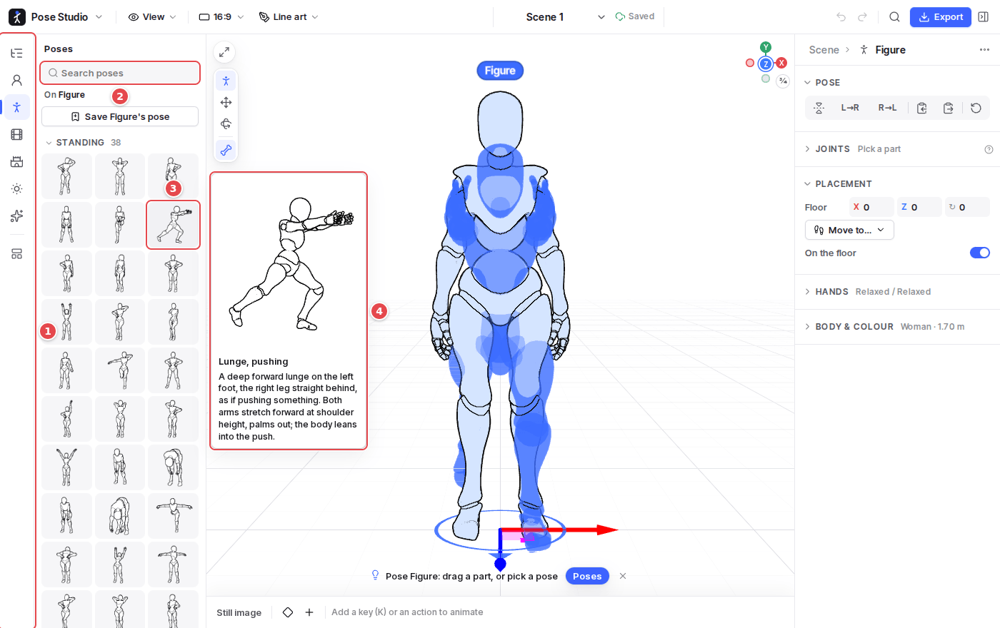
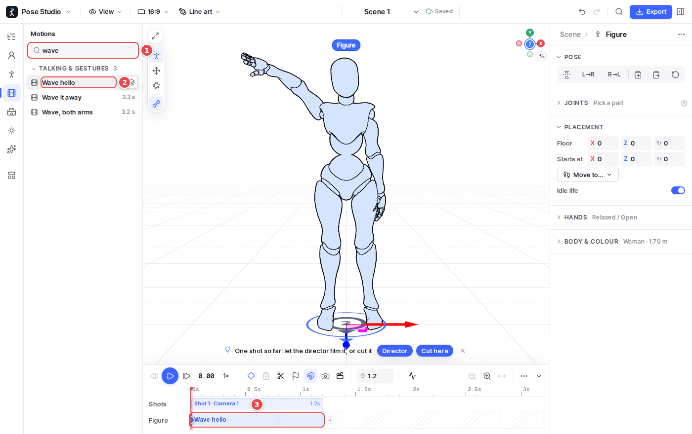

# 4. The Library

The Library is five sections of the rail: **Characters**, **Poses**, **Motions**, **Sets** and **Lighting**. Each has its own search box and groups that fold. What you pick applies to what is selected, and anything can also be dragged onto what it applies to.

## Poses

1. **The rail**: the Library's sections, under the Scene outline.
2. **Search** the section by name or description.
3. **A pose**: click it to put it on the selected figure, where it stands. In an animated scene, it is keyed at the playhead. **Save Figure's pose** (above the grid) keeps your own in the library.
4. **Resting the pointer** on an item shows a preview with its description, and the selected figure shows it as a ghost.

The poses are grouped by posture (standing, sitting and squatting, kneeling and all fours, lying…): the 20 reference poses of the classic drawing sheet, 139 more after a gallery of pose drawings, and your own.

## Motions

1. **Search** motions by what the person does.
2. **A motion**, clicked, goes on the selected figure's track at the playhead, from where it stands and facing its way.
3. **Its block** on the figure's row of the timeline. See [Animation](06-animation.md) for what can be done with it.

Motions come from three places, each a tab (a search looks in all three, as in the picture):

- **Mocap**: 107 clips recorded from people, such as walks and runs, stairs, fights, sport, dances, idles, sitting and talking.
- **Generated**: motions made by Pose Studio itself.
- **Imported**: your own.

**Import motion…** reads BVH, FBX or glTF animation onto the skeleton; a dialog matches any bone it cannot name. Motions of several people (a waltz, a boxing exchange) go on the selected figure, which leads, and the figures nearest it.

## Characters, sets and lighting

- **Characters**: what a figure is drawn as. Click one to apply it to the selected figure, or **Import character…**.
- **Sets**: the place the scene is played in. See [Scenes and sets](05-scenes-and-sets.md).
- **Lighting**: lighting schemes (Studio, Three-point, Rembrandt, Dusk, Night street…). See [Lighting and styles](08-lighting-and-styles.md).

The Library's items are also found by *Find a command* (`Ctrl K`).
