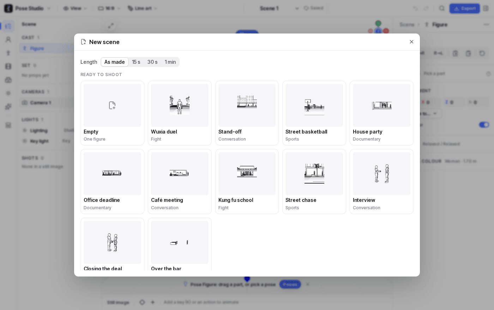
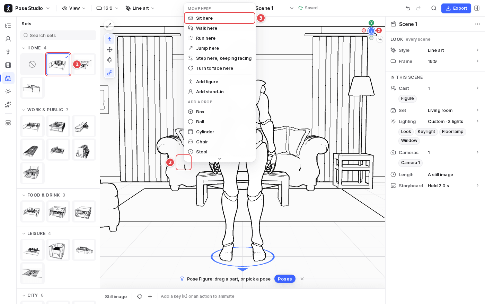

# 5. Scenes and sets

A **project** holds any number of **scenes**. Each scene has its own cast, set, animation and cameras; the project's frame and render style apply to all of them.

## New scenes and templates

**Main menu → New scene…** opens a blank scene, or one made from a template:

- **Ready to shoot**: a scene already filmed by the director in a style that suits it. These include eight staged scenes of a minute or more (a wuxia duel, a stand-off, street basketball, a house party, an office deadline, a café meeting, a kung fu school, a street chase), an interview, and others.
- **Scene templates**: a cast, a set, what they do and the light, but no coverage, so you can film it any way you like.
- **Length**: a template as made, or stretched to 15 s, 30 s or 1 min, with idle life filling the gaps.

Your own: **Save as template…** and **Save as shoot preset…** in the scene's menu (⋯ in the scene picker). A template can also be **put into this scene**: its first role is taken by the selected figure.

The **scene picker** (▾ next to the scene's name) switches, searches, reorders (drag, or `Alt` + arrows), duplicates and deletes scenes, and copies a **share link** for one.

## Sets and furniture

1. **A set** from **Library → Sets**: twenty-nine places to play a scene in. Ten are built here, such as a living room, an office, a café, a palace hall, a city street, a park and a Chinese courtyard; nineteen are ready-made scenes, such as a bedroom, a classroom, a hospital, a pub, a subway car and a Western town. Each is furnished with real models and lit by its own lamps and windows. A set's models are fetched the first time it is shown.
2. **Right-click the furniture**: a set's furniture and walls are the floor where they stand, so the menu acts on the spot at their foot, never on the floor behind a wall. A seat gives the menu **Sit here**, from any side: its back, its front or its top.
3. **Sit here** walks the figure there and sits it down, facing away from the seat's back or towards a table it is at.

Figures also stand on a set's low furniture and steps (a dais, a table, a counter, up to 1.2 m): dragged, walked or jumped onto one, a figure stands on its top. Walls between the view and the people are cut away, so the camera always sees into the room.
