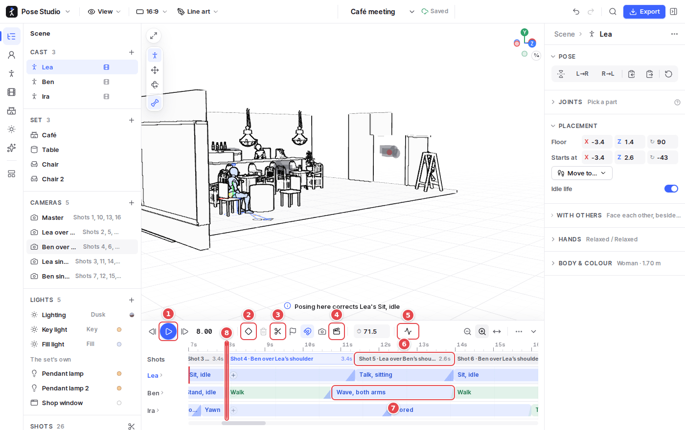
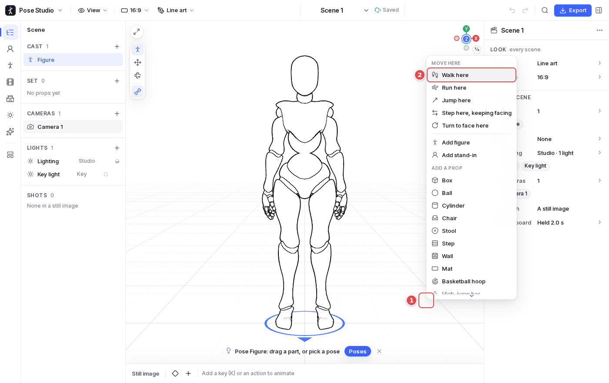
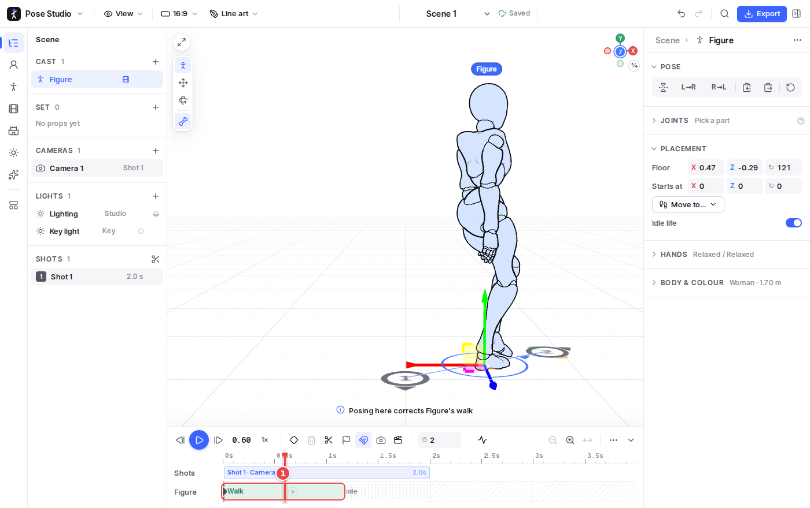
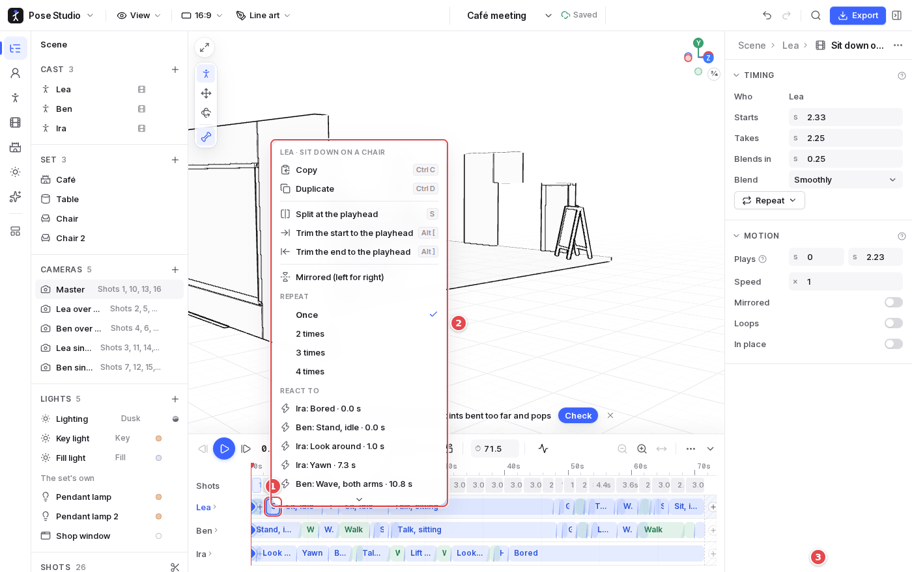

# 6. Animation

A scene is animated as soon as it has a key or an action. Each figure has a **row** on the timeline, and what it does is shown as **blocks**: a walk, run or jump to a spot, a motion, or poses keyed by hand.

## The timeline

1. **Play** (`Space`), at 1×, ½× or ¼× speed. `,` and `.` step a frame. Playing a scene with cameras plays it through its cuts, as filmed, and the editing view comes back when it stops.
2. **Key** (`K`): a key of the selected figure's pose at the playhead. Moving the playhead and posing also keys it (auto-key).
3. **Cut** (`C`): cuts the timeline into shots at the playhead. See [Cameras and shots](07-cameras-and-shots.md).
4. **Director**: films the scene in a style (Conversation, Follow the action, Sports, Fight…), or **By hand**.
5. **Check**: the motion check. It plays the animation through and flags:
   - feet sliding while planted;
   - people passing through each other or through props;
   - joints bent too far, and pops;
   - people hidden from a shot's camera.
   Click an issue to go to it; many have a fix button.
6. **Shots**: one block per shot, with its camera and length. Drag a cut to move it.
7. **A block**: what the figure does.
   - **Click** it to edit it in the inspector: start, length, speed, mirrored, blend, how it gets there, who is in it.
   - **Drag** it to move it; what that person does after comes along.
   - **Drag an edge** to trim it; **Alt-drag** an edge to stretch it.
   - Drag the ramp before it to blend into it.
   - **Right-click** it for more: split, repeat, mirror, copy, save as a motion, remove.
8. **The playhead**: drag it, or click the ruler. Where it is, posing makes a key; over a motion, posing makes a **correction** to the motion around that moment.

The timeline zooms with `Ctrl` + wheel or its zoom buttons and scrolls with `Shift` + wheel. With the timeline focused:

- **Markers** (`M`) are beats on the ruler.
- `I` and `O` set an in and out to loop over.
- Drags snap to the playhead, edges, keys, cuts and markers; the magnet turns snapping off.

## Walking to a spot

1. **Right-click the floor** where the figure should go.
2. **Walk here**, **Run here**, **Jump here**, or **Step here, keeping facing** (side steps and backing up). With a prop in hand, **Throw to…**

1. **The walk's block**. The figure gets there in a natural time, with its steps generated and its feet planted (no sliding). Its marks are numbered discs on the floor, joined by its path; drag one to move the spot. In the walk's inspector, **Steps** can be a real person's (a Mocap walk, jog or sneak) instead of generated ones.

**Move to…** in the figure's inspector, and a figure's right-click menu, do the same: pick the spot afterwards on the floor.

## A block and its menu

1. **The block**, right-clicked, is selected, as a click would, so the inspector shows it.
2. **Its menu**:
   - for a walk, run or jump: how it gets there (glide, walk, run, jump, keeping facing);
   - copy and paste, duplicate;
   - split at the playhead (`S`), trim to the playhead;
   - mirror, repeat 2–4 times;
   - **React to** someone's blow;
   - save as a motion, edit as keys;
   - remove (`Del` leaves a gap; `Shift Del` closes it).
3. **The inspector** shows the block's timing and options.

## Keys, corrections and layers

- **Keys** are diamonds on a row. Drag one to retime it, `Shift`-drag to move the keys after it too, and `Shift`-click to pick several. A key's menu sets how it goes on to the next: smoothly, at an even speed, or held.
- **Corrections**: posing over a motion makes a correction around that moment, faded in and out over half a second. Its band under the row sets how long it fades, or holds it over the whole motion.
- **Layers**: a motion can play on the **upper body**, the **arms**, the **head** or the **legs** over what the figure is doing (a wave while walking).
- **Idle life**: in the gaps, figures breathe, sway and glance at each other.
- **Locking and muting**: a person's row can be **locked** (no changes) or **muted** (stands as posed), from the row's menu.
