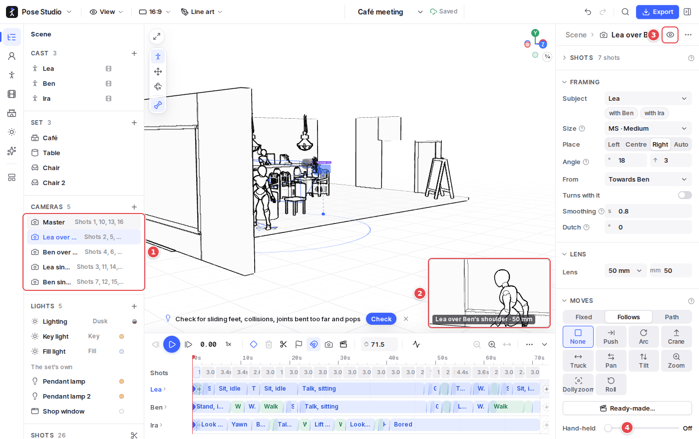
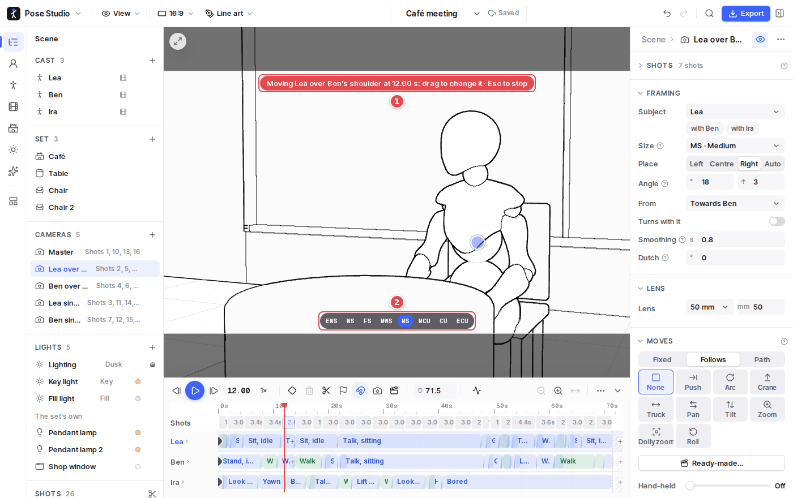
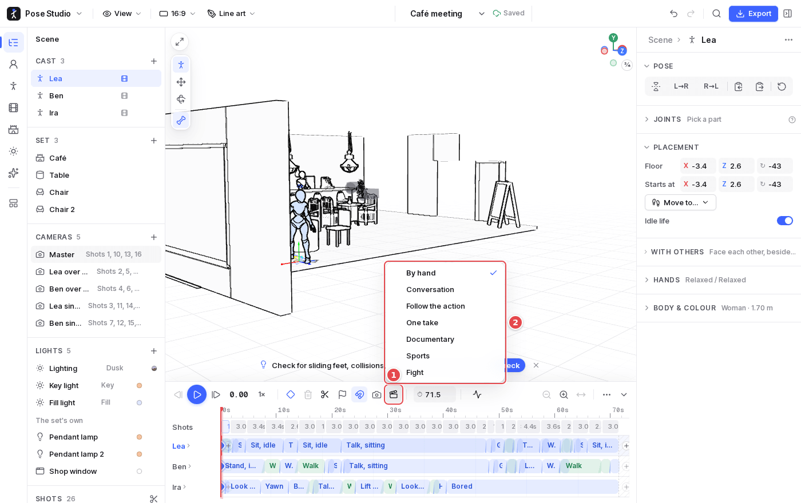

# 7. Cameras and shots

A scene's **cameras** are objects of their own, listed in the Scene outline, each with an inspector. The timeline is cut into **shots**, and each shot films with one camera.

## A camera

1. **Cameras** in the Scene outline, each with the shots that use it. The heading's **+** makes a new camera from the view.
2. **The camera's picture**, live, in the canvas's corner, with its name and lens. Click it to look through the camera.
3. **Look through this camera**: the canvas becomes the camera's view (see below).
4. **The camera's inspector**:
   - **Framing**: its subject (who it films, and with whom), the shot size (extreme wide to extreme close-up), where the subject sits in the frame, and the angle it films from.
   - **Lens**: in millimetres (full frame).
   - **Moves**: **Fixed**, a tripod; **Follows**, which places itself from its subject every frame (follows or circles, holding its angle and size); or **Path**, points it passes through. On a fixed camera, a move over the shot: push, arc, crane, truck, pan, tilt, zoom, dolly zoom or roll.
   - **Hand-held** shake.

On the canvas, a selected camera draws its view cone. A path camera shows its path with a small camera at each point: drag a camera across the floor (`Shift`: up and down), drag its look point to aim it, and double-click the path to add a point.

## Looking through a camera

1. **The banner** says which camera is being moved, at what time. Orbit, pan or dolly the view to change the camera there, and `Esc` stops looking through.
2. **Shot sizes**, from EWS (extreme wide) to ECU (extreme close-up): click one to reframe.

`C` here cuts a new shot at the playhead, filmed by a new camera as the view is. **Framing guides** (View menu) show thirds and safe areas.

## Shots

- `C` (or the scissors) cuts the timeline into shots; drag a cut to move it.
- A shot films with the camera picked in its inspector or its menu (**Film with**), or with a **new camera from the view**.
- A shot **cuts** to its camera or **blends** in from the one before; drag the ramp at its start.
- Each shot has a name and a caption, which go to the storyboard and exports.
- All shots share the project's **Frame**, picked in the top bar.

## The director

1. **Director** on the timeline's bar.
2. **The styles**:
   - **Conversation**: a master two-shot, over-the-shoulder shots and singles.
   - **Follow the action**: wide, tracking when people set off, close for what they do.
   - **One take**.
   - **Documentary**.
   - **Sports**: cutting to whoever gets the ball.
   - **Fight**: a wide shot, low angles on each fighter, close ones, cutting to whoever strikes.

The director places its cameras on who is in the scene and cuts from what they do, and cuts again as the scene changes. A shot you take over by hand (cut, moved or re-filmed) is **pinned** and kept; its menu's **Hand back to the director** lets it be cut again. **By hand** keeps the cameras and cuts as they are from then on.
