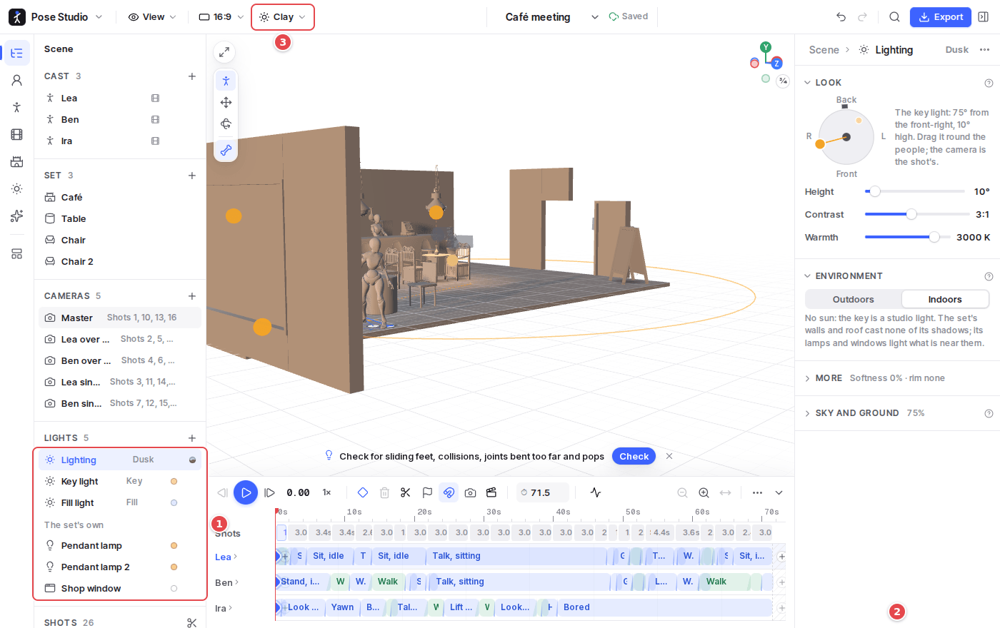
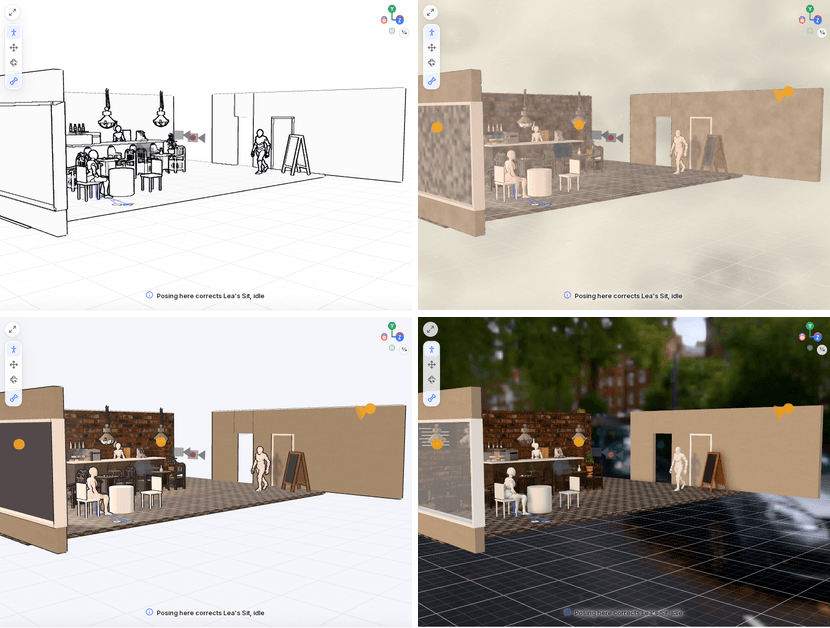

# 8. Lighting and styles

## Lighting

1. **Lights** in the Scene outline:
   - **Lighting**: the look as a whole;
   - the **key** and **fill** lights;
   - the set's own lamps and windows.
2. **The lighting's inspector**:
   - **Look**: where the key light comes from (drag it round the people on the dial; the shot's camera is on it too), how high it is, the contrast (key to fill) and the warmth.
   - **Environment**: indoors or outdoors, and outdoors the time of day and the weather.
   - **More**: softness and the rim light.
   - **Sky and ground**: the light from all round.
3. **Render style**: lighting shows in the lit styles (Pencil, Ink wash, Watercolour, Anime, Pixel, 3D and Clay). In Line art or Minimal, the panel says so and offers to switch to Clay.

Lights keep to their **roles**:

- the **key** is fixed in the scene and is the only light that casts shadows;
- the **fill** and **rim** are placed for each shot's camera;
- **practicals** are a set's lamps and windows, lighting what is near them;
- **follow lights** go with a figure.

A light's lamp on the canvas can be dragged, and **Alt-click** a figure to light it from where you look. **Library → Lighting** has ready schemes: Studio, Three-point, Rembrandt, Dusk, Night street…

## Render styles

The project's **Render style** (top bar, or `L` to cycle) is how the canvas, the storyboard and every export draw the scene:

- **Line art**: clean ink outlines, lines where parts meet, like a drawing reference sheet.
- **Pencil**: graphite lines with a hand-drawn wobble and cross-hatched shading.
- **Ink wash**: dry-brush lines and washes of ink on rice paper.
- **Watercolour**: soft washes in each character's and set's own colours, under a washed sky.
- **Anime**: toon shading with outlines, characters in their own colours and textures.
- **Pixel**: big square pixels in a few flat colours.
- **3D**: a 3D render in the scene's lights and shadows, with textures and a real sky.
- **Clay**: soft studio light with cast shadows, for value studies.
- **Minimal**: flat shapes with a hairline outline.

An export can pick a different style for itself.
