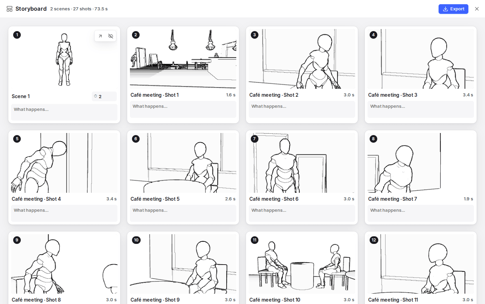
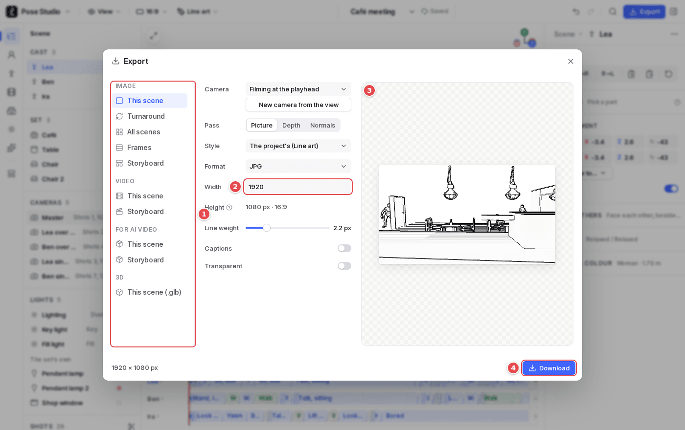

# 9. Storyboard and export

## The storyboard

The storyboard (`B`, or the rail's last section) is the story, shot by shot:

- **The scenes**, in the scene list's order. An animated scene is a numbered panel per shot, through its camera, with its caption and length; a still scene is one panel, held for as long as you set.
- **Drag a panel** to move its scene in the list.
- **A panel's eye button** leaves its scene out of the story.
- **What happens…** under each panel is the shot's caption.
- **Export** (top right) opens the Export dialog on the story: a storyboard image, a video of every shot in order (captions as subtitles), or a keyframe pack.

## Export

1. **What to export**:
   - **Image**: this scene, a **turnaround** from 4 or 8 angles, **all scenes** as a sheet, **frames** of an animation (a motion study), or the **storyboard**.
   - **Video**: this scene, or the storyboard, filmed through its shots (MP4 or WebM, 720p or 1080p, in the project's frame).
   - **For AI video**: a zip per shot with its first and last frame, depth and normal passes, its description and camera path, a greybox clip, and an OpenTimelineIO cut list.
   - **3D**: the scene as a `.glb` for Blender and game engines, animated.
   An option that can't be used yet is greyed out and says why.
2. **Its settings**:
   - the camera a still is taken through (the one filming at the playhead, another camera, or **New camera from the view**);
   - the pass (picture, depth, normals) and the style;
   - the format and size: a still is the project's frame at the width you choose;
   - line weight, captions and a transparent background.
3. **The preview** of what will be exported.
4. **Download**. The size is shown beside it.

Exports film through the scene's cameras, so what you framed is what you get.
