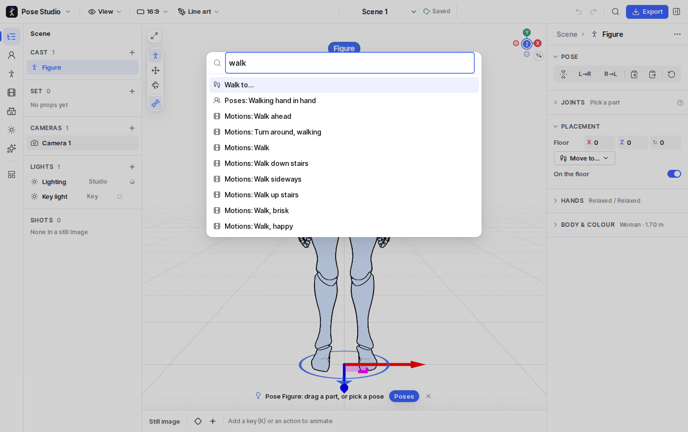
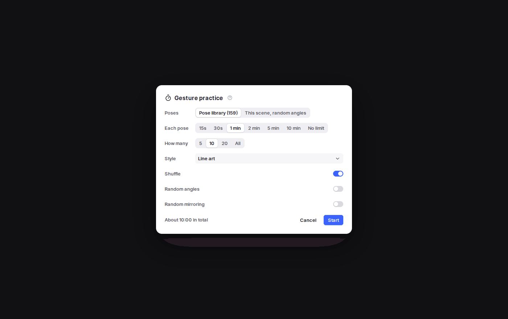
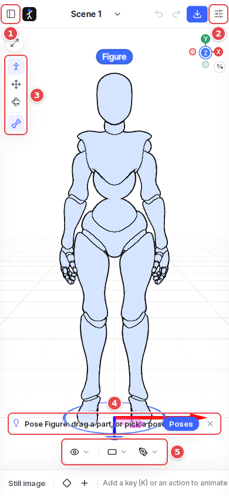

# 10. More

## Find a command

`Ctrl K` (or the magnifier in the top bar) finds any command that applies to the selection, the project's scenes and the Library's items, by name. `Enter` runs the one highlighted.

## The keyboard

`?` lists every shortcut. The most used are:

| Key | Does |
| --- | --- |
| `Q` `W` `E` | Pose, Move, Rotate tool |
| `Ctrl Z` / `Ctrl Shift Z` | Undo / redo |
| `Del`, `Ctrl D`, `F2` | Delete, duplicate, rename the selection |
| `Esc` | Up a level (a part to its figure, then nothing) |
| `F` | Frame the selection |
| `1`–`6` | View from the front, back, left, right, above, three-quarter |
| `Space`, `,` `.` | Play, step a frame |
| `K`, `C`, `S` | Key, cut a shot, split a block |
| `B`, `P` | Storyboard, practice |
| `L` | Next render style |
| `I` | Show or hide the inspector |
| `/` | Isolate the selection |
| `Ctrl K`, `Ctrl E`, `Ctrl S` | Find a command, export, save the project |

The arrow keys move what is selected; see [Posing](02-posing.md). In the panels, `Tab` goes from list to list and the arrows move inside a list; `Shift F10` opens the menu of what has the focus.

## Gesture practice

`P` starts a timed full-screen slideshow for figure-drawing warm-ups. The settings:

- poses from the library, or this scene from random angles;
- 15 s to 10 min per pose, or no limit;
- how many poses, and the style;
- shuffle, random angles and random mirroring.

During a session, the keyboard pauses and skips.

## Figures from a photo

**Add to cast → From a photo…** finds up to four people in a photo, on your device, and poses figures to match: in a new scene, or on the selected figure. A **Photo camera** looks as the photo did.

## Saving and sharing

- The project saves itself in the browser as you work. The indicator by the scene's name says so, and says **Not saved** if the browser refuses; `Ctrl S` still downloads the project then.
- **Main menu → Save / Open… / Add scenes…**: the whole project as a file (scenes, storyboard, your poses, templates, imported motions).
- **Share link** (a scene's menu in the scene picker): one scene, compressed into the link itself. Nothing is sent to a server.
- Several open tabs stay in step, and the app works offline once loaded.

## On a phone

1. **The side panel** opens as a drawer.
2. **The inspector** opens as a drawer too.
3. **The canvas tools**, as on a wide screen.
4. **The hint**: the next step and its buttons, a spot to pick, warnings. A Library section opened from it opens the side drawer.
5. **View, Frame and Render style** float at the canvas's foot.

Drag with a finger as with the mouse. A long press opens the menu of what is under it.

## The AI assistant (server edition)

The **AI assistant** in the rail does what you describe, such as "two people at a café table; she gets up and walks to him; film it in three shots". It uses the same tools as you, and every change can be undone. It needs the server edition, signed in; see the [README](../../README.md).
